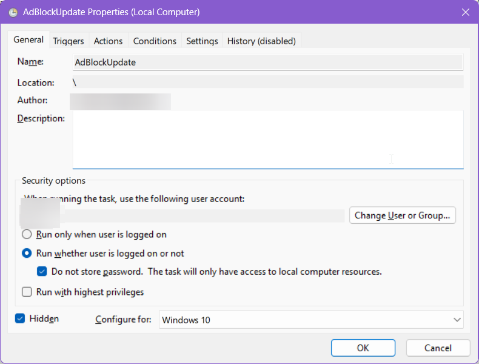

<div align="center">

# HostlistDownloader

A basic utility for Windows and Linux designed for users to download multiple host files from remote URLs, remove empty lines and comments, and consolidate them into a single combined blocklist/whitelist file. Perfect for services like Portmaster.

[](https://github.com/DimonByte/HostlistDownloader/issues)
[](https://github.com/DimonByte/HostlistDownloader/stargazers)
[](/LICENSE)

<br/>
<hr>

## Core Capabilities

HostlistDownloader streamlines hostlists by automatically fetching lists from remote sources that the user configures and merging them into one combined-blocklist/whitelist file.

| Feature | Description |
| :--- | :--- |
| **Automated Data Fetching** | Downloads raw host files directly from all configured URLs defined within the `settings.json` file. |
| **Smart Update Checking** | Uses conditional requests (`ETag` / `Last-Modified`) so unchanged lists are not downloaded again. |
| **Concurrent Downloads** | Downloads several sources at once (configurable). |
| **Any Input, Any Output** | Reads hosts files, plain domain lists, adblock/AdGuard rules, dnsmasq, unbound and RPZ, and writes any of the supported output formats. |
| **Data Cleaning & Merging** | Strips comments and junk (`localhost`, `broadcasthost`...), validates domains, converts internationalised names to punycode, and removes duplicates after formatting. |
| **Safe Updates** | Every download and every output is written to a temporary file first and only replaces the previous version once it is complete and validated. A failed source keeps its last good copy. |
| **Customization** | Combine downloaded lists with your own block and allow rules, and protect critical domains with `neverBlock`. |

<hr>

# How to Configure and Use

### Step-by-Step Setup Guide
1.  **Initial Run:** Run HostlistDownloader once. It creates a default `settings.json` and tells you where it is (see [Data folder](#data-folder)), then exits with code `3`.
2.  **Editing Settings:** Open `settings.json` and add your list sources. You can also adjust the output format, concurrency and other options described below.
3.  **Execution:** Run HostlistDownloader again. It downloads the lists and writes the combined output files (`HLDcombined-...txt`).

#### Running Scheduled Tasks (Silent Operation):
To configure a task schedule to run silently, set up the task using the following settings: "Run whether user is logged on or not," "Do not store password," and "Hidden." Add `--quiet` to the arguments. The next time this scheduled task runs, it will execute without any visible prompts and will save the last run's results. **Any result code other than `0x0` indicates a problem occurred** (see [Run Result Codes](#run-result-codes-error-codes)).



### Data folder

`settings.json`, the logs and the downloaded lists live in the data folder, chosen in this order:

1. `--data-dir <path>` on the command line.
2. The `HLD_DATA_DIR` environment variable.
3. The program's own folder, **if `settings.json` (or an empty `portable.txt`) is already there**. Existing installs keep working unchanged.
4. Otherwise the per-user data folder: `%LOCALAPPDATA%\HostlistDownloader` on Windows, `~/.local/share/hostlistdownloader` on Linux, `~/Library/Application Support/HostlistDownloader` on macOS. This works when the program is installed under Program Files.

<hr>

## Commands & Arguments

Run with no command to update the lists. Only one command can be given at a time. Options use `--long` names; the older `/slash` spellings (`/q`, `/fresh`, `/search`...) still work but are deprecated and log a notice.

| Type | Command | Arguments | Description |
| :--- | :--- | :--- | :--- |
| **Commands** | *(none)* | | Download the sources and rebuild the combined lists if anything changed. |
| | `--merge` or `--regenerate` | | Rebuild the combined lists from the cached sources without downloading (for example after changing `formattype` or a user rule). Changes to settings are also picked up automatically on the next normal run. |
| | `--search <domain>` or `-s` | `<domain>` | Show which sources and rules match a domain, and whether it is in the final list. |
| | `--stats` | | Entry counts, sizes and dates of the output files, and a configuration summary. |
| | `--diff` | | How many entries were added and removed in the last publish. |
| | `--revert` | | Swap the combined lists with their `.bak` copies (requires `"allowRevert": true`). Running it again swaps back. |
| | `--update` | | Install the latest HostlistDownloader release (Windows). The download is verified against GitHub's SHA-256 digest. |
| | `--validate` | | Check `settings.json` and list every problem. Exit code `22` if problems were found. |
| | `--validate --fix` | | Apply the fixes shown by `--validate`. The original is saved as `settings.json.bak`. |
| | `--dupscan` | | How much each cached list overlaps with the others (blocklists against blocklists, whitelists against whitelists, plus blocklist entries overridden by a whitelist). |
| | `--dupanalyse <file>` | `<file>` | Detailed overlap report for one cached list (file name or source name). |
| | `--getsource <file>` | `<file>` | Show the URL a cached file was downloaded from. |
| | `--disable` | | Replace the three combined lists with empty files (turns filtering off for anything watching them). Scheduled updates keep running and write to `*.disabled` copies. |
| | `--enable` | | Put the lists back, including any updates made while disabled. |
| | `--help` or `-h` / `--version` | | Help and version. |
| **Update options** | `--fresh` | | Re-download every source, ignoring cache validators and the size sanity check, then rebuild. |
| **Global options** | `--quiet` or `-q` | | No console output (the log file is still written; fatal errors go to stderr). |
| | `--debug` | | Show detailed output and write debug lines to the log. |
| | `--no-banner` | | Do not print the version banner. |
| | `--no-update-check` | | Skip the automatic new-version check for this run. |
| | `--purge-logs` | | Delete all log files before running. |
| | `--data-dir <path>` | `<path>` | Use a different data folder. |
| **Sources** | `--add-blocklist <url>` / `--remove-blocklist <url>` | `<url>` | Add or remove a blocklist source. |
| | `--add-whitelist <url>` / `--remove-whitelist <url>` | `<url>` | Add or remove a whitelist source. |
| **User Rules** | `--add-user-block <rule>` / `--remove-user-block <rule>` | `<rule>` | Add or remove your own block rule (`example.com`, `*.example.com`, `\|\|example.com^`). |
| | `--add-user-allow <rule>` / `--remove-user-allow <rule>` | `<rule>` | Add or remove your own allow rule. |

Several `--add-*` / `--remove-*` options can be combined in one call. Ctrl+C cancels a run cleanly; the published lists are left unchanged.

<hr>

## Settings Configuration (`settings.json`)

`settings.json` accepts `//` comments and trailing commas. Unknown setting names are reported as errors, so typos are caught instead of silently ignored. Files from version 2.x are upgraded automatically on the first run (the original is kept as `settings.json.v1.bak`).

### Example `settings.json`

```json
{
  "version": 2,
  "blocklists": [
    { "url": "https://raw.githubusercontent.com/StevenBlack/hosts/master/hosts" },
    { "url": "https://cdn.jsdelivr.net/gh/hagezi/dns-blocklists@latest/wildcard/pro-onlydomains.txt", "name": "HaGeZi Pro" },
    { "url": "https://someonewhocares.org/hosts/zero/hosts", "enabled": false }
  ],
  "whitelists": [],
  "formattype": "domain",
  "userWebsiteBlocklist": [ "tracker.example.com" ],
  "userWebsiteWhitelist": [ "*.cdn.example.net" ],
  "neverBlock": [ "windowsupdate.com", "update.microsoft.com" ],
  "maxConcurrentDownloads": 4,
  "logExpiryInDays": 7,
  "allowInsecureSources": false,
  "maxListSizeInMB": 100,
  "allowRevert": false,
  "checkForUpdates": true,
  "updateCheckIntervalHours": 24,
  "network": {
    "connectTimeoutSeconds": 15,
    "responseTimeoutSeconds": 30,
    "inactivityTimeoutSeconds": 60,
    "maxRetries": 3,
    "userAgent": null,
    "proxy": null
  },
  "output": {
    "sort": true,
    "lineEnding": "lf",
    "header": true,
    "hostsBlockIp": "0.0.0.0",
    "compress": false,
    "validateDomains": true,
    "rejectPublicSuffixes": true
  },
  "sourceSanityCheck": {
    "enabled": true,
    "maxShrinkPercent": 50,
    "maxGrowPercent": 1000,
    "minimumBytes": 10240
  }
}
```

Only `blocklists` is required; anything left out uses the defaults shown above.

### Settings reference

| Setting | Default | Description |
| :--- | :--- | :--- |
| `blocklists`, `whitelists` | `[]` | Sources. Each is an object: `url` (required, `http(s)://` only), `enabled` (default `true`), `name` (shown in reports), `maxSizeMB` (overrides `maxListSizeInMB` for this source), `sha256` (expected hash, for pinned lists that never change). Disabled sources keep their cached copy. |
| `formattype` | `domain` | Output format, see below. An unknown value is an error. |
| `userWebsiteBlocklist`, `userWebsiteWhitelist` | `[]` | Your own rules, in any supported syntax. They are formatted like everything else. |
| `neverBlock` | OS update domains | Domains (and their subdomains) that are never blocked, whatever a source says. Applied to the blocklist and combined outputs. |
| `maxConcurrentDownloads` | `4` | 1-25. |
| `logExpiryInDays` | `7` | Logs not written to for this many days are deleted. `0` keeps only today's log. |
| `allowInsecureSources` | `false` | Allow `http://` sources. |
| `maxListSizeInMB` | `100` | Maximum size of one downloaded list (after decompression), 1-1000. |
| `allowRevert` | `false` | Keep `.bak` copies of the outputs for `--revert`. |
| `checkForUpdates`, `updateCheckIntervalHours` | `true`, `24` | Background check for a new version after an update run, at most once per interval. |
| `network.*` | | Connect timeout, time to first response, maximum time without receiving data, retry count, User-Agent override, and an optional HTTP proxy. Without `proxy`, the system proxy is not used. |
| `output.sort` | `true` | Sort entries so diffs between runs are meaningful. |
| `output.lineEnding` | `lf` | `lf`, `crlf` or `native`. |
| `output.header` | `true` | Comment header with timestamp, entry count and sources. |
| `output.hostsBlockIp` | `0.0.0.0` | Address used for every entry in `hosts` format. |
| `output.compress` | `false` | Drop `sub.example.com` when `example.com` is blocked. Only for `adblock`, `dnsmasq` and `unbound`, where one entry covers its subdomains. |
| `output.validateDomains` | `true` | Drop entries that are not valid host names. |
| `output.rejectPublicSuffixes` | `true` | Drop bare TLDs and public suffixes such as `com` or `co.uk`. |
| `sourceSanityCheck.*` | | Reject a download that shrank or grew by more than the given percentage compared with the cached copy (cached copies smaller than `minimumBytes` are not checked). The cached copy is kept; `--fresh` accepts the new version. |

### `"formattype"` Explained

Every source is parsed into domains first, whatever its format, so any input works with any output.

| Value | Output Format | `*.example.com` | Best For |
| :--- | :--- | :--- | :--- |
| `domain` *(default)* | `example.com` | Written as `example.com` | Simple domain lists |
| `hosts` / `host` / `pihole` / `pi-hole` | `0.0.0.0 example.com` | Left out (hosts files have no wildcards) | Hosts files, Pi-hole |
| `iponly` | `192.0.2.10` | Left out | IP blocklists (only real addresses; `0.0.0.0`/`127.0.0.1` are skipped) |
| `adblock` / `ublock` / `ublock origin` / `adguard` | `\|\|example.com^` | `\|\|example.com^` (already covers subdomains) | uBlock Origin, AdGuard, AdGuard Home |
| `wildcard` | `*.example.com` | Kept | Wildcard lists |
| `dnsmasq` | `address=/example.com/0.0.0.0` | Same line (already covers subdomains) | dnsmasq |
| `unbound` | `local-zone: "example.com." always_null` | Same line (already covers subdomains) | Unbound |
| `rpz` | `example.com CNAME .` | `*.example.com CNAME .` | BIND / PowerDNS response policy zones |
| `raw` | Original line (comments removed) | Kept | Debugging |

Names are case-insensitive. For `adblock`, `dnsmasq`, `unbound` and `rpz`, an allowed subdomain of a blocked domain gets an exception line (for example `@@||good.example.com^`) so the whitelist still works. `HLDcombined-whitelist.txt` contains plain domains (or `@@` rules for `adblock`).

<hr>

## File Structure Overview

| Path / Filename | Functionality |
| :--- | :--- |
| `settings.json` | **Configuration:** All runtime settings and the list sources. |
| `hostfiles/combined/HLDcombined-blocklist.txt` | **Output:** All blocklist entries, formatted and de-duplicated (`neverBlock` applied). |
| `hostfiles/combined/HLDcombined-whitelist.txt` | **Output:** All whitelist entries. |
| `hostfiles/combined/HLDcombined-list.txt` | **Output:** The blocklist with the whitelist applied (useful for filters requiring a single input). |
| `hostfiles/blocklist/*`, `hostfiles/whitelist/*` | **Cache:** One file per source, named `<host>_<hash>.txt`, with a `.meta` file holding its cache validators. Names stay the same when other sources are added or removed. Files that do not follow this pattern are never deleted. |
| `logs/` | Daily logs. URLs in logs have credentials and query strings hidden. |
| `state/` | Internal bookkeeping (last build fingerprint, last update check, run lock). |

<hr>

## Run Result Codes (Error Codes)

> If you encounter an error code, please first check the detailed log generated by HostlistDownloader on the day of the failure.

| Code | Meaning | Details |
| :--- | :--- | :--- |
| **[0x0] (0)** | **Success** | The lists were updated, or were already up to date. |
| **[0x1] (1)** | General error occurred. | Non-specific issue requiring review of the detailed log file. |
| **[0x2] (2)** | Network connection failed. | No network was available. Cached copies are still used if the output needs rebuilding. |
| **[0x3] (3)** | First run. | `settings.json` was just created and needs configuring. |
| **[0x4] (4)** | Already running. | Another HostlistDownloader process is using the same data folder. |
| **[0xA] (10)** | Directory creation failed. | Check permissions. Ensure security software is not blocking folder access. |
| **[0x14] (20)** | File missing. | A needed file was not found, or no blocklists are configured. |
| **[0x15] (21)** | Config corruption detected. | `settings.json` is not valid JSON or contains an unknown setting name. |
| **[0x16] (22)** | Invalid configuration entry. | A value in `settings.json` cannot be used (for example an unknown `formattype`), or `--validate` found problems. |
| **[0x1E] (30)** | Missing parameters. | A command was given without its value (for example `--search` with no domain). |
| **[0x1F] (31)** | Invalid arguments. | Unknown argument, or two commands at once. |
| **[0x28] (40)** | Error during update process. | No source could be used, or building/publishing the output failed. The previous lists are unchanged. |
| **[0x29] (41)** | Update completed with issues. | At least one source failed (it keeps its last good copy); the rest updated. |
| **[0x2A] (42)** | Data validation check failed. | The new output looked wrong (for example empty) and was not published. |
| **[0x33] (51)** | Update in progress. | `--update` staged the new version and exited so it can be swapped in. |
| **[0x82] (130)** | Cancelled. | Stopped with Ctrl+C. Nothing was published. |

## Upgrading from 2.x

* `settings.json` is converted automatically: sources become objects, entries that started with `#` become `"enabled": false`, `whitelist` becomes `whitelists`, and `maxDownloadThreads` becomes `maxConcurrentDownloads`.
* Cached lists are renamed to the new stable names on the first run, keeping their ETags, so nothing is downloaded again.
* `/slash` arguments still work; switch scheduled tasks to the `--long` names when convenient.
* Output files now use LF line endings and are sorted by default (`output.lineEnding`, `output.sort`). The `hosts` format writes every entry with `0.0.0.0` (`output.hostsBlockIp`), and `HLDcombined-whitelist.txt` contains plain domains.
* Exit code 50 (wrong directory) no longer exists: the program can be started from any folder.

<hr>
